# Reporte técnico — Math & English Quest

**Aplicación móvil educativa para practicar matemáticas y vocabulario en inglés**

| |                                                              |
|---|--------------------------------------------------------------|
| **Institución** | Universidad Politécnica del Estado de Chiapas                |
| **Materia** | Desarrollo de Aplicaciones Móviles                           |
| **Producto** | Proyecto integrador — Unidad 3                               |
| **Aplicación** | Math & English Quest                                         |
| **Versión** | 26.1.2                                                       |
| **Tecnologías** | Kotlin · Jetpack Compose · MVVM · Room · Retrofit · Firebase |
| **Equipo** | Santos Enoch González Pérez · Leonardo Nucamendi Ruiz        |
| **Fecha** | 9 de noviembre de 2026                                       |

---

## 1. Resumen del producto

**Math & English Quest** es una aplicación Android para niños de primaria que practica dos
habilidades al mismo tiempo: **cálculo mental** y **vocabulario en inglés**. El estudiante
resuelve operaciones en el módulo del Dado, escucha y repite números y frases, y consulta un
diccionario; su maestro, desde su propia cuenta, revisa la **evidencia fotográfica** del
procedimiento que el alumno hizo en su libreta.

### 1.1 Problema que resuelve

En la práctica docente, revisar el procedimiento de cada alumno implica recoger libretas.
La aplicación digitaliza ese proceso: el estudiante **fotografía su procedimiento** al
resolver un ejercicio y la foto viaja a la nube, donde el maestro la consulta desde su clase
sin necesidad de estar en el mismo lugar.

### 1.2 Usuarios

| Rol | Qué puede hacer |
|---|---|
| **Estudiante** | Practicar los módulos, guardar su progreso y subir evidencias a su portafolio |
| **Maestro** | Generar un código de clase (y su QR), ver a sus estudiantes y revisar sus portafolios |
| **Invitado** | Usar los módulos sin cuenta; su avance se queda solo en el teléfono |

### 1.3 Propuesta de valor

1. Dos materias en una sola app (matemáticas + inglés).
2. Retroalimentación inmediata paso a paso, “como en el cuaderno”.
3. Evidencia real del trabajo del alumno, en la nube y disponible para el maestro.
4. Funciona sin internet con lo último descargado.

---

## 2. Funcionalidades

| Módulo | Descripción |
|---|---|
| **Registro e inicio de sesión** | Roles estudiante, maestro e invitado. Cuentas con Firebase Authentication. El estudiante se une a una clase con un **código** o **escaneando su QR**. |
| **Dado** | Ejercicios con jerarquía de operaciones; modos Directo, Normal y Rush; cuatro dificultades que se desbloquean por rachas; vidas, comodín y progreso guardado. Desde cierta dificultad pide la **foto del procedimiento**. |
| **Cómo se resuelve** | Procedimiento paso a paso: suma y resta en columna con acarreos, multiplicación y **división en forma de casita**. Incluye decimales, negativos y una calculadora. |
| **Portafolio** | Evidencias del estudiante agrupadas por día, con filtro por dificultad. |
| **Mi Clase** | Código de clase y su **QR**, lista de estudiantes con búsqueda y orden, y el portafolio de cada uno en solo lectura. |
| **Diccionario** | Busca una palabra en inglés en una **API externa**, la traduce al español en el dispositivo, reproduce su pronunciación y guarda el historial para consultarlo sin internet. |
| **Números y Frases** | Práctica con voz; en Frases se puede responder hablando. |
| **Tema y sonido** | Tema claro/oscuro y pantalla de inicio con audio. |

### 2.1 Recorrido del estudiante

| Inicio de sesión | Inicio del estudiante |
|---|---|
| 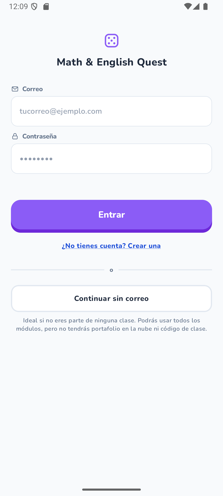 | 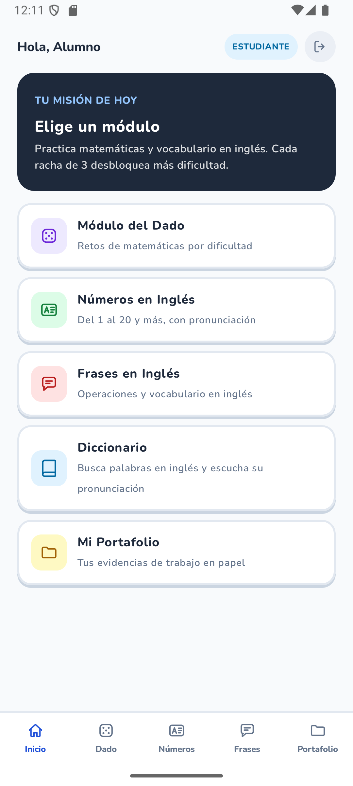 |

El módulo del Dado genera un ejercicio y muestra **vidas y racha**. En dificultades medias y
altas, antes de ver las opciones pide la **foto del procedimiento**, que se toma con la cámara
o se elige de la galería:

| Ejercicio con vidas y racha | Foto del procedimiento |
|---|---|
| 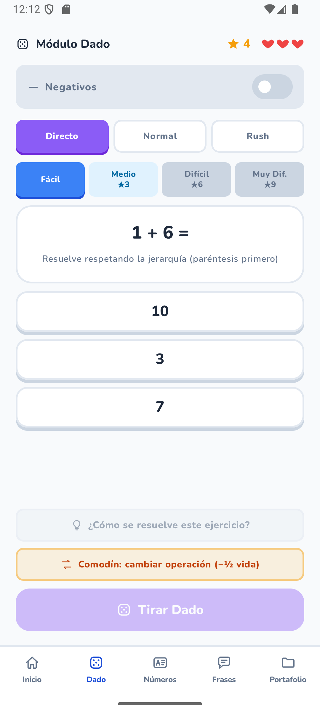 | 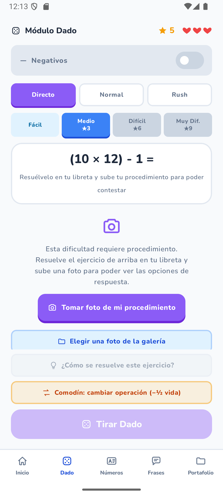 |

La ayuda “¿Cómo se resuelve?” explica cada paso. La división se dibuja con la **casita**,
igual que en el cuaderno, y el estudiante puede probar otra operación:

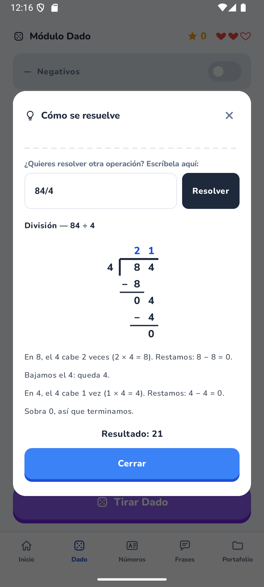

### 2.2 Portafolio y panel del maestro

| Portafolio del estudiante | Mi Clase del maestro |
|---|---|
| 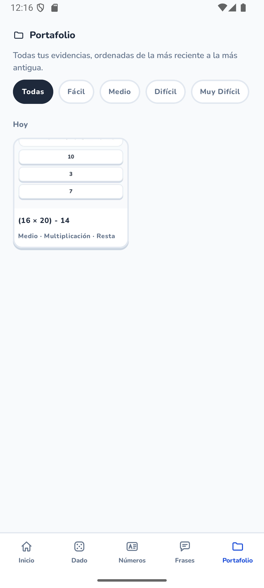 | 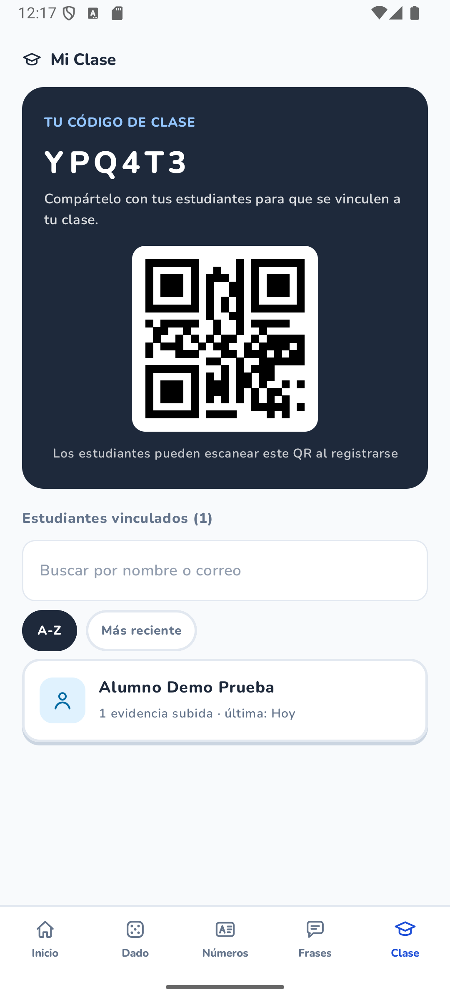 |

El maestro comparte su **código y QR**; al abrir a un estudiante puede revisar sus evidencias
en solo lectura:

| Portafolio visto por el maestro | Registro del maestro con QR |
|---|---|
| 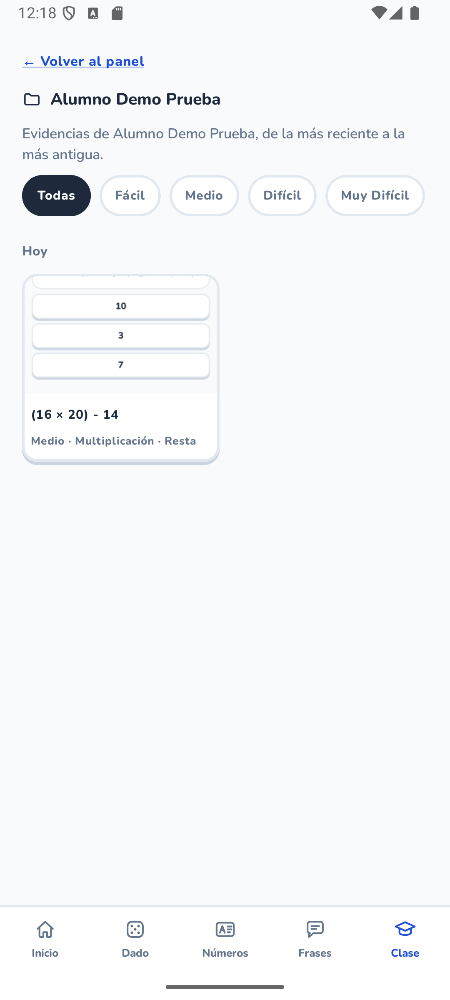 | 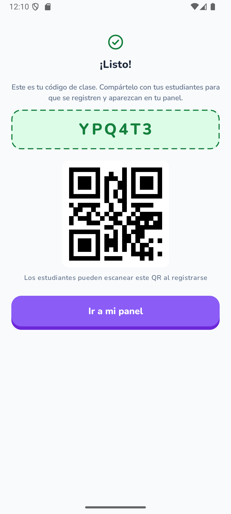 |

### 2.3 Diccionario

Busca en una API real, traduce en el dispositivo y reproduce la pronunciación:

| Traducción y fonética | Sin conexión | Error con reintento |
|---|---|---|
| 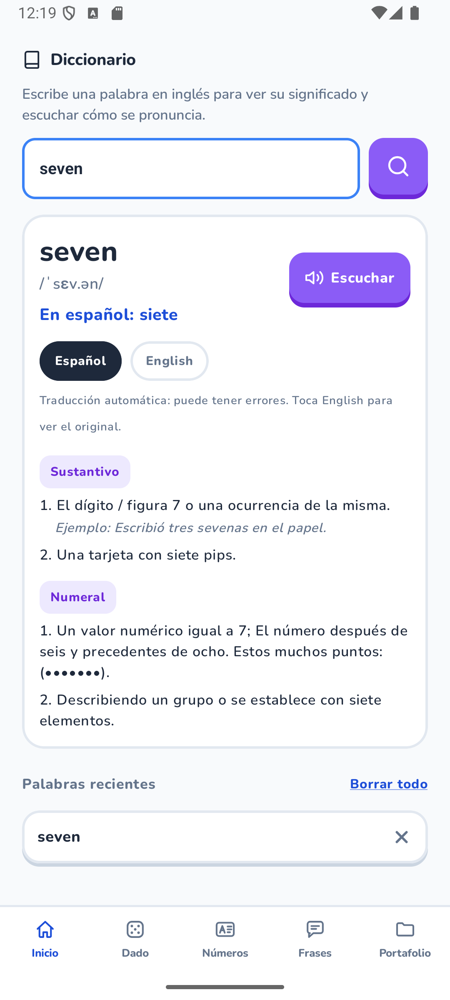 | 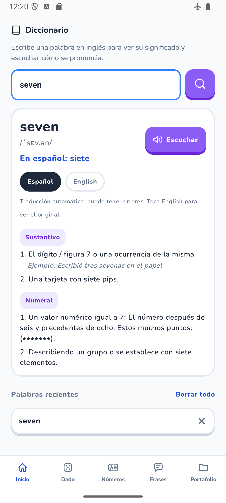 | 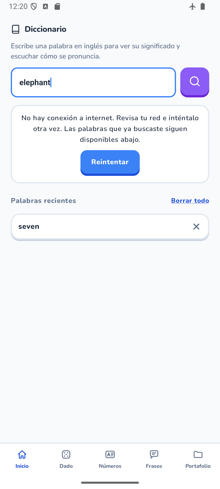 |

### 2.4 Números, Frases y tema oscuro

| Números y Frases | Modo oscuro |
|---|---|
| 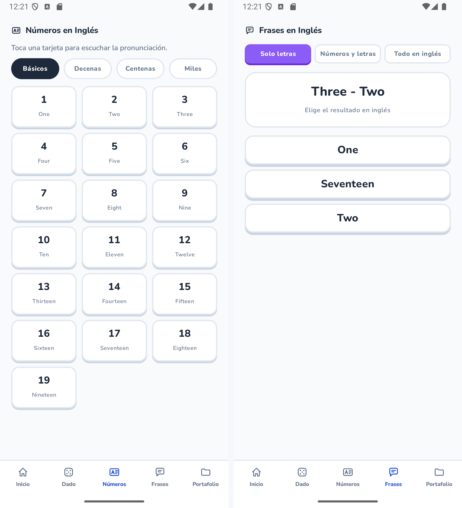 | 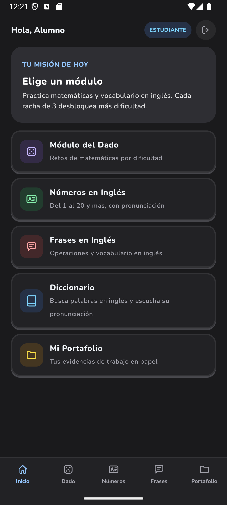 |

---

## 3. Arquitectura MVVM

### 3.1 Capas

```
┌──────────────────────────────────────────────────────────────┐
│  UI (Jetpack Compose)                                        │
│  Pantallas que observan un UiState y emiten eventos           │
└───────────────┬──────────────────────────────────────────────┘
                │ eventos            ▲ StateFlow<UiState>
┌───────────────▼────────────────────┴─────────────────────────┐
│  ViewModel (uno por pantalla)                                 │
│  Valida, coordina y convierte resultados en estados           │
└───────────────┬──────────────────────────────────────────────┘
                │
┌───────────────▼──────────────────────────────────────────────┐
│  Repositorios (reglas de negocio y decisión de fuente)        │
│  AuthRepository · ClassRepository · EvidenceRepository ·      │
│  DadoProgressRepository · DictionaryRepository                │
└──────┬──────────────────┬──────────────────┬─────────────────┘
       │                  │                  │
┌──────▼──────┐  ┌────────▼────────┐  ┌──────▼──────────────┐
│ Room        │  │ Retrofit        │  │ Firebase            │
│ (caché)     │  │ (API externa)   │  │ Auth/Firestore/     │
│             │  │                 │  │ Storage             │
└─────────────┘  └─────────────────┘  └─────────────────────┘
```

### 3.2 Estructura de paquetes

```
com.upchiapas.mathenglishquest
├── data
│   ├── local/          Room: base, DAO, entidades, migraciones, sesión
│   ├── remote/         Firebase (Auth, Firestore, Storage) y Retrofit
│   │   ├── dictionary/ DTOs, mapeo y cliente de la API
│   │   └── translation/ Traducción con ML Kit
│   ├── repository/     Implementación de los repositorios
│   └── model/          Modelos de datos
├── domain              Reglas puras (Dado, Cómo se resuelve, portafolio)
├── integration/qr      Generación y lectura de QR
├── ui
│   ├── navigation/     Rutas y NavHost
│   ├── screens/        Una carpeta por pantalla (pantalla + ViewModel + UiState)
│   ├── components/     Componentes reutilizables
│   └── theme/          Colores, tipografía y tema claro/oscuro
├── di/AppContainer     Inyección de dependencias manual
└── utils/              Audio, voz, imágenes, archivos
```

### 3.3 Flujo de una operación

Ejemplo: **buscar una palabra en el diccionario**

1. La pantalla Compose envía lo que se escribe con `viewModel.onQueryChange(...)` y, al pulsar
   buscar, llama `viewModel.onSearch()`.
2. `DictionaryViewModel` pasa el estado a `LOADING` y lanza una corrutina en `viewModelScope`
   que llama al repositorio. Si el campo está vacío, responde `INVALID` sin llamar a nada.
3. `DictionaryRepository` valida y normaliza la palabra (solo letras en inglés), la pide a la
   API mediante `DictionaryRemote` (implementado con Retrofit en `RetrofitDictionaryRemote`) y,
   si no hay internet, recurre a lo guardado en el dispositivo.
4. El resultado (`LookupResult`) se convierte en `DictionaryUiState`: éxito, no encontrada,
   sin conexión, error del servidor o texto inválido. Con la palabra ya en pantalla, el
   ViewModel prepara en segundo plano su audio y su traducción.
5. La pantalla observa el `StateFlow` y se redibuja. **La vista nunca conoce Retrofit ni la
   base de datos.**

El mismo camino se sigue al guardar una evidencia: la pantalla entrega la foto al ViewModel,
el repositorio la comprime, la sube a Storage, registra la ficha en Firestore y actualiza la
copia local.

### 3.4 Estado y dependencias

- Cada pantalla expone un `UiState` inmutable mediante `StateFlow` / `MutableStateFlow`.
- Las corrutinas viven en `viewModelScope`; las tareas de fondo, en un `CoroutineScope`
  propio del contenedor.
- `AppContainer` crea y comparte una sola instancia de base de datos, sesión, clientes de
  Firebase, Retrofit y repositorios (inyección manual, sin librerías externas).

---

## 4. Consumo de API y tratamiento de datos

### 4.1 API externa

- **Servicio:** [Free Dictionary API](https://dictionaryapi.dev)
- **Endpoint:** `GET https://api.dictionaryapi.dev/api/v2/entries/en/{palabra}`
- **Cliente:** Retrofit + Gson + OkHttp.
- **Datos que aporta a la app:** definiciones, categoría gramatical, fonética y audio.

### 4.2 Estados contemplados

| Situación | Comportamiento |
|---|---|
| Consulta en curso | Indicador de carga |
| Palabra encontrada | Definiciones, fonética, traducción y botón *Escuchar* |
| Palabra inexistente (HTTP 404) | Mensaje “palabra no encontrada” |
| Sin conexión | Mensaje claro + botón **Reintentar** y diccionario local disponible |
| Error del servidor | Mensaje con el código y opción de reintentar |
| Respuesta rara o vacía | No se cierra la app; se informa |

### 4.3 Traducción y voz

La traducción al español se hace **dentro del teléfono** con **ML Kit Translate**: la app
envía el texto a un traductor local y muestra «En español: …» bajo la palabra, con los
significados traducidos y un aviso de *traducción automática*. Los botones **Español / English**
permiten alternar con el original. El primer uso descarga el modelo del idioma (unos 30 MB). La pronunciación se reproduce con `TextToSpeech` y
con el audio que devuelve la API, que se guarda en caché para escucharlo sin internet.

### 4.4 Persistencia del historial

Las búsquedas se guardan en el dispositivo (historial, traducciones y audio). Por eso, en
**modo avión** el usuario sigue viendo las palabras que ya consultó y recibe un aviso claro
cuando pide una nueva.

---

## 5. Interfaz con Jetpack Compose y navegación

- **100 % Compose**, sin XML de layouts.
- Tema propio con **modo claro y oscuro**, tipografía y componentes reutilizables
  (`ChunkyButton`, tarjetas, cabeceras, diálogos).
- **Navegación centralizada** en `Screen.kt` con rutas tipadas:

  ```
  splash · login · register_role · register_student · register_teacher
  teacher_code/{code} · home · dado · numeros · frases · portfolio
  diccionario · clase · clase_alumno/{studentId}
  ```

- Se pasan **identificadores mínimos** entre pantallas (por ejemplo `studentId`), nunca
  objetos completos.
- Las listas largas usan desplazamiento y los textos se adaptan al ancho; los iconos llevan
  `contentDescription` para accesibilidad.
- Barra inferior con las secciones principales, distinta para estudiante y maestro.

---

## 6. Gestión de datos y persistencia local

| Dato | Dónde vive | Por qué |
|---|---|---|
| Cuentas | **Firebase Authentication** | Contraseñas cifradas y sesión segura |
| Perfiles, clases | **Firestore** | Compartidos entre dispositivos |
| Evidencias (fotos) | **Firebase Storage** + ficha en Firestore | La imagen no viaja en la base de datos |
| Estudiantes, evidencias (copia) | **Room** | Pantallas rápidas y funcionamiento sin internet |
| Sesión abierta | **SharedPreferences** | Saber quién entró al abrir la app |
| Progreso del Dado | **SharedPreferences** + **Firestore** | Se recupera al cambiar de celular |
| Diccionario | **SharedPreferences** (historial, última respuesta y traducciones) y **archivos** en la carpeta privada de la app (audio de pronunciación) | Consulta sin conexión |

Room está en la **versión 6**, con migraciones que conservan los datos del usuario
(`2→3`, `3→4`, `4→5`, `5→6`). La app funciona como **caché local**: pinta desde Room y
sincroniza con la nube cuando hay conexión.

### 6.1 Justificación

- **Room** para datos estructurados que la interfaz recorre con frecuencia (listas,
  filtros, conteos).
- **SharedPreferences** para preferencias pequeñas y de lectura inmediata.
- **Firebase** como fuente de verdad compartida entre alumno y maestro.

---

## 7. Integraciones del dispositivo

Se eligieron **tres** de las integraciones del curso, todas con un propósito real en la app:

### 7.1 Cámara y galería

- `ActivityResultContracts.TakePicture` para la foto del procedimiento.
- `PickVisualMedia` para elegir una imagen existente.
- `FileProvider` para compartir el archivo temporal de forma segura.
- La imagen se **comprime y se corrige la orientación** antes de subirse.

### 7.2 Audio

- `MediaPlayer` para el sonido de inicio.
- `TextToSpeech` para pronunciar números, frases y palabras.
- Reconocimiento de voz en el módulo de Frases.
- Reproducción del audio de pronunciación descargado de la API.

### 7.3 Códigos QR

- **Generación** del QR de la clase con ZXing (el maestro lo comparte).
- **Escaneo** con Google Code Scanner, que no requiere permiso de cámara.
- El contenido del QR es un texto propio (`MEQ-CLASE:CODIGO`) que la app valida antes de
  usarlo: solo acepta códigos de 6 a 8 caracteres de los que genera el registro del maestro.
  También acepta el código a secas.

> La aplicación declara únicamente el permiso `INTERNET`.

---

## 8. Estabilidad, validaciones y pruebas

### 8.1 Validaciones

- Nombre completo (mínimo tres palabras), correo con formato válido y contraseña de al menos
  6 caracteres.
- Código de clase existente antes de crear la cuenta.
- Manejo de errores de red y de credenciales con mensajes comprensibles.
- Reintento en el diccionario y respaldo local cuando falla la nube.

### 8.2 Pruebas unitarias

**162 pruebas**, todas en verde:

| Suite | Pruebas |
|---|---|
| `HowToTest` | 46 |
| `DadoLogicTest` | 26 |
| `DictionaryRepositoryTest` | 25 |
| `DadoGameStateTest` | 15 |
| `DictionaryMapperTest` | 11 |
| `ClassRosterTest` | 9 |
| `PortfolioGroupingTest` | 9 |
| `ClassQrPayloadTest` | 9 |
| `RetrofitDictionaryRemoteTest` | 7 |
| `QrMatrixTest` | 4 |
| `ExampleUnitTest` | 1 |

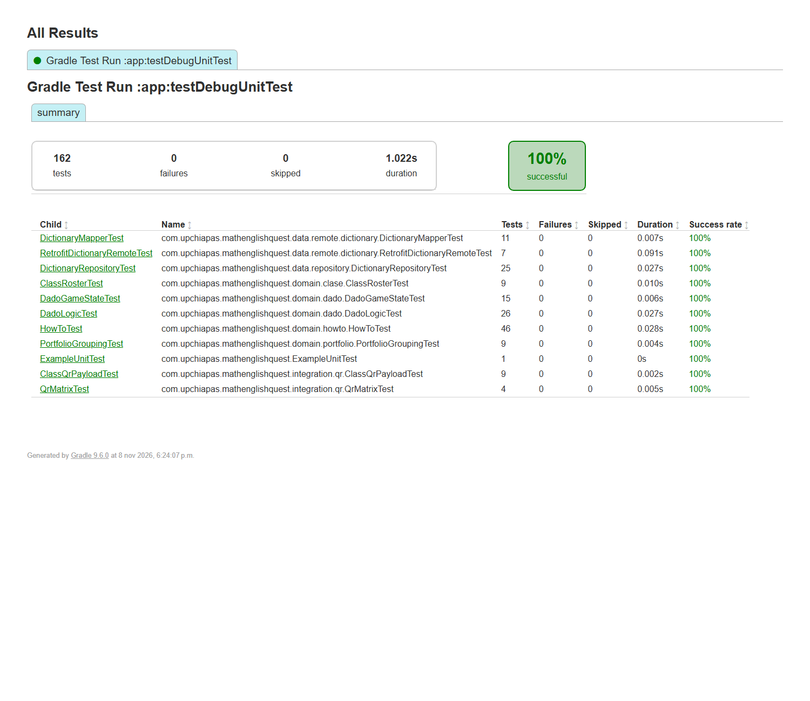

---

## 9. Repositorio, versión y entrega

- **Repositorio:** `github.com/EnochGonzalez/MathEnglishQuest-Android`
- **Ramas (política del curso):** `main` conserva solo la estructura inicial, sin código
  funcional; `develop` contiene el código integrado y de ahí salen las versiones; cada cambio
  se desarrolla en una rama `feature/*` y entra a `develop` mediante *Pull Request*.
- **Versión identificada:** `26.1.2` (`versionName` en Gradle).
- **Documentación:** `README.md` con instrucciones, `docs/EMPEZAR.md` (puesta en marcha y
  guía de la API) y `docs/firestore.md` (esquema de datos y reglas).
- **APK:** adjunto al *release* `v26.1.2` de GitHub (publicado desde `develop`). También se
  genera con `./gradlew assembleDebug` en `app/build/outputs/apk/debug/app-debug.apk`.
- **Evidencias:** esta carpeta, `docs/evidencias/`.

### Cómo ejecutar

```bash
# El código está en la rama develop. Requiere app/google-services.json (proyecto Firebase)
git switch develop
./gradlew assembleDebug
adb install -r app/build/outputs/apk/debug/app-debug.apk
```

---

## 10. Conclusiones

El proyecto cumple el objetivo de integrar, en un caso de uso real, los elementos del curso:
arquitectura **MVVM** con estado observable, consumo de una **API externa** con manejo de
errores, interfaz **Compose** con navegación completa, **persistencia local** con Room y
SharedPreferences, y **tres integraciones del dispositivo** (cámara/galería, audio y QR).

El aprendizaje principal fue separar responsabilidades: al concentrar el acceso a datos en
repositorios, fue posible cambiar la fuente (de una base local a Firebase) sin reescribir las
pantallas. La app queda preparada para seguir creciendo con nuevos módulos y para que una API
propia consuma los mismos datos.
